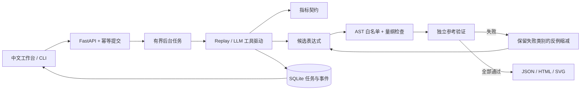

<p align="center"></p>

# MetricForge

**金融指标的生成、参考验证与可追溯交付。**

[](https://github.com/00lostin00/MetricForge/actions/workflows/ci.yml)
[](pyproject.toml)
[](LICENSE)


[快速启动](#快速启动) · [交互工作台](#交互工作台) · [系统结构](#系统结构) · [验证记录](#验证记录) · [参考与比较](#参考与比较) · [文档](#文档)

收入同比用错分母，表达式仍然能编译；金额单位不统一，结果可能看起来合理。MetricForge 把指标口径写成契约，先编译受约束表达式，再用独立参考程序逐条比对；失败时保留反例，修订后重新验收。交付包含表达式、验证记录、来源、图表与 HTML 报告。

当前提供 **净利率、营业收入同比、经营现金净利润比** 三个指标契约。默认 Replay 演示“错误候选 → 反例 → 修订 → 验收”的完整过程，不需要模型密钥。LLM 模式由模型通过工具提出候选，沿用相同验证边界。

## 快速启动

需要 Python 3.11+ 与 [uv](https://docs.astral.sh/uv/)。

```bash
git clone https://github.com/00lostin00/MetricForge.git
cd MetricForge
uv sync --frozen --all-extras
uv run --frozen --all-extras uvicorn metricforge.api:app --host 127.0.0.1 --port 8014
```

打开 **http://127.0.0.1:8014/** 即可使用中文工作台。API 文档位于 http://127.0.0.1:8014/docs。Windows 也可运行 `./start.ps1`，用 `-Port` 指定端口。

命令行交付：

```bash
uv run --frozen --all-extras metricforge "新增营业收入同比，核对年度和单位" --metric revenue_yoy
```

命令打印 JSON 与 HTML 报告路径。CLI 和 API 使用各自的状态目录。

## 交互工作台


1. 选择指标，阅读契约口径，再填写需求；可修改种子与生成样本数量。
2. 点击“开始验证与交付”，后台运行真实编译、参考验证与反例缩减。
3. 比较候选表达式、通过样本数、失败数和缩减反例，展开真实工具日志。
4. 查看验收图表，打开完整 HTML 报告，下载交付 JSON 或 SVG 图表。
5. 点击最近任务恢复结果；最近 10 项记录保存在当前浏览器，清空只删除本地历史。

页面提供加载、错误、队列满、未配置模型与中断状态，支持手机窄屏。暂停刷新只停止页面轮询，后台任务继续执行。前端使用原生 HTML / CSS / JavaScript，静态文件由 FastAPI 同源提供，无需 Node 或前端 CDN。

## 系统结构



| 环节 | 已实现的机制 | 可检查的输出 |
| --- | --- | --- |
| 表达式编译 | 字段、加减乘、`safe_div`、`abs`、`lag(field,1)`；AST 白名单、节点预算、量纲检查 | 编译诊断、依赖、节点数 |
| 参考验证 | Decimal 计算，金额单位先归一化，比较状态、未舍入比率及来源 | 每条失败的预期与实际结果 |
| 反例缩减 | 最多 80 次尝试，保留失败类别与状态 | 原反例、缩减反例及尝试数 |
| Agent 边界 | 6 类工具，最多 3 个候选、20 次工具调用、8 轮模型消息 | 候选历史与事件轨迹 |
| 后台执行 | 2 个 worker、6 个在途任务，SQLite 持久化，幂等提交 | 任务状态、冲突 / 容量响应 |
| 交付 | 重新验证通过后冻结表达式，再输出图表和报告 | JSON、HTML、SVG |

工具执行不运行任意 Python 或 Shell。约 90 秒的执行预算在工具调用间检查，不是外部模型请求的强制超时。当前仅面向单实例本地使用，没有账户鉴权与分布式任务恢复。

## 验证记录

```bash
uv run --frozen --all-extras pytest
uv run --frozen --all-extras ruff check .
uv run --frozen --all-extras python tools/evaluate.py
uv run --frozen --all-extras python tools/smoke_http.py
```

- 原有验证记录：**1440 次预设正确表达式参考比对**，**17 种预定义缺陷检出**（4 种静态、13 种语义）。范围与统计口径见[验证说明](docs/validation/validation.md)。
- 80 项 Python 测试覆盖 DSL、参考验证、缩减、幂等、容量、报告及新增工作台接口；新增测试验证三个指标的提交、轮询、候选修订、事件和下载。
- [收入同比示例报告](docs/validation/revenue_yoy/report.html)保留候选、验证与反例。新任务的报告包含本次运行耗时与实际调用数。
- [浏览器验收记录](docs/validation/browser-workbench.json)记录三个指标、历史恢复、下载和桌面/手机检查；[交付报告截图](docs/screenshots/report.png)来自本地运行结果。

数据与公司均为虚构教学样本。Replay 是固定策略工具演示；上述数字不是模型成功率，也不是与其他项目的性能比较。真实模型调用效果需要配置模型后另行评测。

## 模型配置

在启动服务前设置 `OPENAI_API_KEY` 与 `METRICFORGE_MODEL`，工作台会开放 LLM 选项；模型需要支持工具调用。运行 CLI 时追加 `--provider llm`。项目不自动加载 `.env`。

模型配置仅在服务端使用，浏览器只获取“已配置 / 未配置”状态，不接收密钥或模型名称。接口组装与工具消息协议有本地测试；实际调用会将需求发送给所配置的模型提供方，可能产生费用。

## 参考与比较

以下项目用于理解相关工程方法和边界；表格是**能力定位比较**，没有执行横向性能测试。它们未被集成为 MetricForge 的运行依赖，也不表示合作或官方背书。

| 参考项目 | 官方项目的定位 | MetricForge 对应的设计与边界 |
| --- | --- | --- |
| [Great Expectations](https://github.com/great-expectations/great_expectations) | 以 Expectations 表达数据质量检查，生成验证结果与文档 | 用指标契约明确口径，保存参考验证与交付报告；仅覆盖三个指标，不提供通用数据源接入与完整数据质量平台 |
| [dbt](https://github.com/dbt-labs/dbt) | 通过模型组织数据仓库转换，管理模型关系和测试 | 保存表达式依赖与交付记录；不执行数据仓库 SQL，不替代 dbt 的模型构建、调度与生态 |
| [SQLGlot](https://github.com/tobymao/sqlglot) | SQL 解析、转译、优化及表达式树处理 | 采用受约束 AST 和编译诊断；这里是独立实现的金融指标 DSL，不支持 SQL 方言转换 |

能否编译、指标语义是否正确、来源是否一致，分别需要不同检查。项目重点是把这几项检查放进一个可复现的候选修订流程，展示错误如何被定位和修复。

## 文档

- [工作台操作说明](docs/FRONTEND.md)：界面、演示步骤、历史、导出与故障处理。
- [技术指南](docs/guide.md)：数据、DSL、参考验证、工具、任务和实验。
- [HTML 阅读版](docs/guide.html)。
- [验证记录](docs/validation/validation.md)。

源码仓库包含 `fixtures`；独立 wheel 部署需额外提供数据目录，并用 `METRICFORGE_ROOT` 指定项目数据根目录。Web 静态文件随 Python 包分发。API 可用 `METRICFORGE_STATE` 指定可写状态目录。

MIT License.
